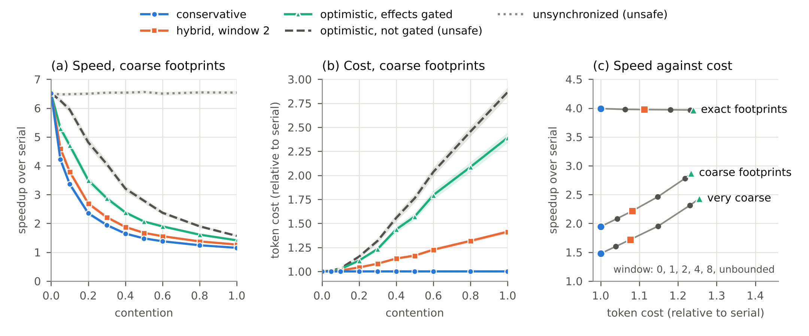

# En-Masse (prototype)

**En**abling **M**ulti-**A**gent **S**ynchronization-**S**pace **E**xploration.

A prototype simulator for exploring synchronization policies for multi-agent
execution, from conservative to optimistic.

**Status: early prototype.** It simulates agents; it does not run them. The
workload model is synthetic and deliberately coarse. The numbers below show
that the instrument works and that the expected trade-offs appear. They are not
measurements of real LLM agents.

This repository contains  a prototype for work in progress.  The larger project
aims to create a unified framework for design space exploration of
synchronization policies for multi agent execution. This prototype simulation
framework is one part of the project, while the goal is to develop a unified
synchronization model, a range of actual pluggable synchronization policies
ranging from conservative to optimistic, the design space explorer along with a
simulator and workflow models and experimental results.

## The idea in brief

Several agents work at the same time on shared state (files, tickets, a
cluster). A run is correct if it is equivalent to running the agents one after
another in a fixed order. A synchronization policy decides, each time an agent
is about to take a step, whether to

- **run** the step now and treat it as final,
- run it **speculatively** (take a checkpoint; it may be rolled back), or
- **wait**.

The engine keeps a commit point for every agent. A step is *safe* when nothing
that can still happen could invalidate it. Safe steps need no checkpoint, and
their irreversible effects can be released at once. A policy only chooses what
to do with steps that are not yet safe. This one interface expresses the whole
range:

| Policy | Rule |
|---|---|
| `Serial` | one agent at a time (the reference) |
| `Conservative` | run only safe steps |
| `Hybrid(window=w)` | run safe steps; otherwise speculate, holding at most `w` unconfirmed steps; hold irreversible effects until safe |
| `gated_optimistic()` | `Hybrid` with an unbounded window |
| `Optimistic` | always run; repair by rollback; irreversible effects are not held |
| `Unsynchronized` | always run; no repair |

How much a conservative policy can run in parallel depends on how well agents
declare, in advance, what they may write (their footprint). The workload
generator has a knob for footprint quality.

A **policy-independent checker** reads the execution trace and reports stale
reads, reads of values from the future, and irreversible effects that were
released and then rolled back. The same checker judges every policy.

## Quick start

```
pip install -e ".[experiments,dev]"
python -m pytest -q
python experiments/run_sweeps.py
python experiments/plot_figure.py
```

```python
import numpy as np
from enmasse import generate, simulate, check, Hybrid

tasks = generate(np.random.default_rng(0), contention=0.3, footprint_slack=3)
metrics, engine = simulate(tasks, Hybrid(window=2))
print(metrics["speedup"], metrics["token_ratio"], check(engine))
```

## First results



Setting: 8 agents, 12 steps each, 12 shared objects, 10% of steps irreversible,
200 random workloads per point, every policy on the same workloads. Shaded
bands are 95% confidence intervals. "Contention" is the share of steps that
touch shared state. In panel (b) the unsynchronized line lies under the
conservative one at 1.0.

What the figure shows:

1. **No policy wins everywhere.** At contention 0.3 with coarse footprints, the
   conservative policy reaches 1.94x the serial speed at no extra token cost.
   Gated optimistic execution reaches 2.87x and costs 1.23x the tokens. The
   hybrid with a window of 2 sits between them (2.21x, 1.08x).
2. **Footprint quality decides whether speculation pays** (panel c). With exact
   footprints the conservative policy already finds all the concurrency there
   is (3.99x), and speculation only adds cost. With coarse footprints,
   speculation buys speed, and the window size selects a point on the curve.
3. **Safety has a price, and the checker makes it visible.** Releasing
   irreversible effects without gating is faster (4.06x at contention 0.3) but
   leaks 2.9 irreversible effects per run, in 83% of runs. No synchronization
   at all is fastest (6.5x) and produces 12 causality violations per run. The
   conservative, hybrid and gated policies had zero violations in every run.

The full safety table is in `results/summary.md`.

## What is modelled, and what is not

Modelled: step durations and token cost, reads and writes on shared objects,
irreversible effects, declared footprints, checkpoint cost, undo cost, rollback
with cascades, and an optional discount for repairing instead of redoing.

Not modelled yet: real agents and tools, nondeterministic re-execution, LLM
serving capacity and rate limits, message passing between agents, human
approval delays, failures, and calibration against real traces. These are the
subject of the planned work.

## Layout

```
enmasse/workload.py     synthetic workload generator
enmasse/policies.py     the policies
enmasse/engine.py       discrete-event engine, commit points, rollback
enmasse/checker.py      policy-independent correctness checker
experiments/            sweeps and the figure
tests/                  unit tests
results/                CSV output, figure, safety summary
```

## License

Code in this repository is licensed under the Apache License, Version 2.0 (see
`LICENSE`). Documentation, course material and datasets released by the project
are licensed under CC BY 4.0.

## Author
Neha Karanjkar (Assistant Professor, IIT Goa)
https://nehakaranjkar.github.io


